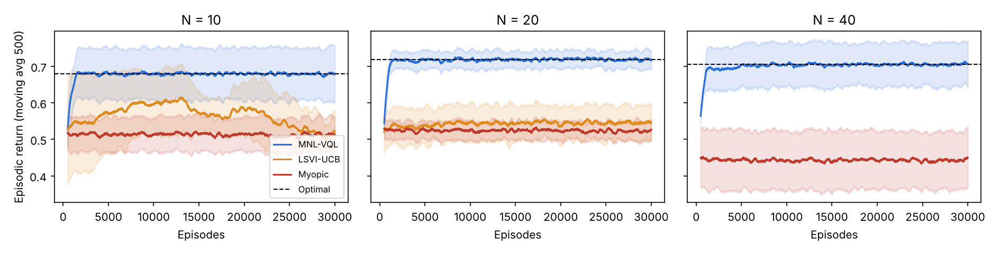
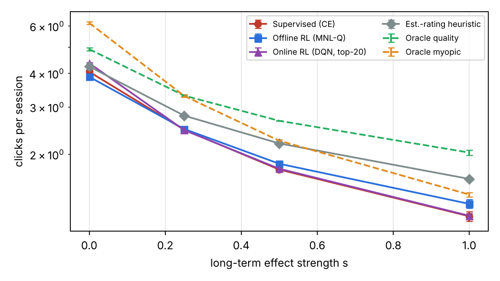

**Code:** https://github.com/samyakbansal5-eng/rl-seqrec (every number below is produced by a script in `scripts/`; the README lists the commands).

# 1. Question and approach

A supervised sequential recommender is trained to predict the next click, so it optimises *short-term* engagement (click-through rate, CTR). An RL recommender maximises a discounted sum of future rewards, so it can in principle trade a click now for more engagement later. The topic asks **when the RL recommender actually wins on long-term utility**, and suggests an extension to **re-ranking**, where several items are shown at once.

Our approach is to put both recommenders inside **one model**, so the comparison is precise rather than anecdotal:

1. **Formulation.** We use the episodic *combinatorial MDP with multinomial-logit (MNL) choice* of Lee & Oh (ICML 2025). In it, the supervised next-click recommender is exactly the myopic ($\gamma = 0$) policy (Lemma 1), the RL recommender is the $\gamma > 0$ policy, and the slate size $K$ is an explicit parameter ($K = 1$: sequential recommendation; $K > 1$: re-ranking).
2. **Theory.** Two propositions bound when RL can help: it can be arbitrarily better (Prop. 1), and it cannot help at all if what the user picks does not change the user's future (Prop. 2).
3. **Reproductions.** (a) Labarca et al. (ICML 2024) on RetailRocket, the reference point for "RL for sequential recommendation" on logged data; (b) Lee & Oh's synthetic experiment, the reference point for combinatorial RL with MNL feedback.
4. **Controlled experiment.** A MovieLens-1M user simulator with a single knob $s$ for how strongly the user's choice affects their future (satisfaction, fatigue, leaving). $s = 0$ satisfies the assumption of Prop. 2 exactly. We compare supervised, offline RL and online RL recommenders as $s$ grows.

# 2. Formulation

**Combinatorial MDP with MNL choice.** At step $h$ the recommender sees state $s_h$ (user, recent clicks, step), shows a slate $A_h$ of at most $K$ items, the user picks one item or the outside option $a_0$ ("no click") with probability
$$P(a \mid s, A) = \frac{e^{v(s,a)}}{1 + \sum_{a' \in A} e^{v(s,a')}}, \qquad P(a_0 \mid s, A) = \frac{1}{1 + \sum_{a' \in A} e^{v(s,a')}},$$
the recommender gets reward $r = 1$ for a click, and the user's state moves to $s_{h+1} \sim p(\cdot \mid s_h, a_h)$, which depends on **what was picked**. The item-level and slate-level values are
$$\bar Q_h(s,a) = r(s,a) + \gamma\, \mathbb{E}_{s' \sim p(\cdot|s,a)} V_{h+1}(s'), \qquad Q_h(s,A) = \sum_{a \in A \cup \{a_0\}} P(a \mid s, A)\, \bar Q_h(s,a).$$
So only item-level values must be learned; the best slate maximises a ratio of linear functions of the item weights $e^{v}$, which is a linear program after the Charnes–Cooper transformation, or equivalently a one-dimensional bisection on the ratio (both implemented in `rlrec/slate/assortment.py` and verified against brute force on 300 random instances).

**Metrics.** Short-term: CTR of the first slate, $1 - P(a_0 \mid s_1, A_1)$. Long-term: expected clicks per session (return with $\gamma = 1$) and session length.

**Lemma 1 (supervised = myopic).** With unit click rewards, the slate with the highest immediate reward is the $K$ items with the largest utilities, because the click probability $W/(1+W)$ increases in $W = \sum_{a\in A} e^{v(s,a)}$. A cross-entropy next-click model recovers the utilities up to a constant, so its top-$K$ is the myopic ($\gamma = 0$) policy. This is what turns "supervised vs RL" into "$\gamma = 0$ vs $\gamma > 0$" in one model.

**Proposition 1 (RL can be arbitrarily better).** For any $n$ there is an MDP where the optimal long-term return exceeds $n$ times the myopic return. *Construction:* a junk item that is more clickable than a good item but makes the user leave; the myopic policy always shows junk and gets at most one click; showing the good item collects $H c_g$ clicks. This is the dual of Labarca et al.'s Theorem 4.3, which shows the opposite direction for one-step metrics (an RL-optimal policy can be arbitrarily worse at next-item prediction). Neither objective dominates; the metric and the dynamics decide.

**Proposition 2 (no advantage without choice-dependent dynamics).** If $p(\cdot \mid s, a)$ does not depend on the chosen item $a$ (including no click), the myopic policy is optimal for every $\gamma$. *Proof idea:* the future term $c(s) = \gamma\,\mathbb{E}[V(s')]$ is then the same for every item, the choice probabilities over a slate sum to one, so $Q(s,A) = (\text{immediate reward of } A) + c(s)$ and the same slate maximises both.

**Corollary.** The RL advantage requires that *what the user picks changes their future*. The strength of that dependence is the first axis of our regime map; slate size $K$ (via the two-type good/junk toy model in Section 4 of `report/formulation.tex`) and $\gamma$ are the others.

# 3. Reproduction 1: Labarca et al. (2024) on RetailRocket

**What the paper claims.** Adding an RL loss (SQN: a Q-learning head trained by TD on clicks = 1 / purchases = 5 rewards) to GRU4Rec or SASRec improves next-item prediction; but similar gains come from *non-RL* auxiliary heads (EVAL: predicting the SARSA return; HIST: predicting the number of past interactions), so the gains come from representation learning, not from RL itself.

**What we implemented** (`rlrec/models/seqrec.py`, `scripts/train_nip.py`). Preprocessing as SQN/the paper: views are clicks, add-to-cart are purchases, sessions and items with at most 2 interactions removed, time-based 80/10/10 split. Our data matches the paper's statistics (195,524 sessions, 70,852 items, 57,269 purchases). GRU4Rec and SASRec (hidden 64, state length 10), heads CE / SQN / EVAL / HIST, $\gamma = 0.5$, lr 0.005, batch 256; full-ranking HR@k and NDCG@k for click and purchase targets; model selection on validation purchase NDCG@20.

**Status.** On a 4-core CPU one epoch takes 45–75 minutes, so the full grid (8 models x 5 seeds x up to 50 epochs) is being run on a Colab GPU (`notebooks/colab_s4.ipynb`). Partial CPU results (1 seed, 2–3 epochs):

{{S4_TABLE}}

**Observation (important for interpretation).** Our absolute purchase metrics are about twice the paper's (e.g. GRU4Rec CE purchase HR@20 0.46 vs 0.23). We traced this to repeat consumption: **67% of purchase targets in our test set are the item the user viewed just before** (view, then add-to-cart), and 73% are in the 10-item history (24% and 37% for click targets). Any model that learns "recommend what was just viewed" scores highly on purchases. The paper's pipeline likely differs in how such repeats are handled. We therefore reproduce the *protocol* and compare *relative* differences between heads; with 2–3 epochs, SQN is still below CE, which is too early to conclude anything. The final comparison will use the GPU run.

# 4. Reproduction 2: Lee & Oh (2025) synthetic combinatorial MDP

**Setting** (`rlrec/sim/budget_env.py`). The paper's synthetic "budget" MDP: $N$ items, $S = 5$ states, horizon $H = 5$, slates of up to $M = 6$ items, MNL choice with linear utilities $\phi^\top\theta$, rewards and transitions that depend on the chosen item. The optimal policy is computed exactly by dynamic programming with the exact assortment solver.

**Agents** (`rlrec/agents/combinatorial.py`). *Myopic* (OFU-MNL+-style: learns $\theta$ online, offers the best immediate assortment), *LSVI-UCB* (tabular optimistic value iteration that treats every assortment as a separate action, the "holistic" baseline), and *MNL-VQL* (the paper's algorithm: online-mirror-descent MNL estimate, optimistic / overly-optimistic / pessimistic item values with the paper's switching rules, assortments chosen by optimisation). 30,000 episodes, 5 seeds.

**Results** (mean episodic return over the last 2,000 episodes, ± std over 5 seeds):

{{S5_TABLE}}

{ width=100% }

MNL-VQL reaches the optimal value (within 1%) for all $N$; the myopic learner converges to a clearly suboptimal policy (25–37% below optimal) because it ignores how the choice changes the next state; LSVI-UCB learns slowly because the number of assortments grows combinatorially (we ran it only up to $N = 20$). This reproduces the paper's qualitative result (its Figure 1) and is the first, clean instance of "RL beats myopic when transitions depend on the choice".

# 5. MovieLens-1M user simulator

KuaiRec (planned in the proposal) was not obtainable from our environment, so the simulator is calibrated on MovieLens-1M, as Lee & Oh do (`data/preprocess_ml1m.py`, `rlrec/sim/user_sim.py`).

* **Catalogue:** the 500 most-rated movies. **Preferences:** ALS matrix factorisation (rank 32) on all 1M ratings gives a predicted rating $\hat r_{ui}$ for every user and movie.
* **Junk items:** the bottom 25% of the catalogue by mean rating (popular but poorly rated). They are made *more* clickable (utility bonus $\kappa = 1$), like clickbait.
* **Choice:** MNL with $v(u,i) = b_0 + (\hat r_{ui} - 3.5) + \kappa\,\mathrm{junk}_i - s\,\lambda_f\,\mathrm{fatigue}\cdot\mathrm{genres}_i$.
* **Long-term dynamics, scaled by strength $s \in [0,1]$:** clicking an item changes a hidden satisfaction $\sigma$ by $s\,\eta\,(q_{ui} - q_{\mathrm{ref}})$ (good movies raise it, bad ones lower it); a junk click lowers it further and makes the user leave with probability $0.3\,s$; repeated genres build fatigue. Each step the user leaves with probability $0.05 + 0.4\,s\,(1 - \sigma)$; sessions are capped at 30 steps.
* **Key property:** at $s = 0$ nothing the user picks affects the future, so by Prop. 2 the myopic policy is optimal. Increasing $s$ switches the long-term effects on gradually.

**Sanity check with oracles** (`scripts/sim_sanity.py`; "myopic oracle" = top-$K$ by true current utility, "quality oracle" = best predicted rating, never junk):

| setting | myopic oracle clicks/session | quality oracle clicks/session |
|---|---|---|
| $s = 0$, $K = 1$ | 6.19 | 4.95 |
| $s = 0.25$, $K = 1$ | 3.24 | 3.29 |
| $s = 0.25$, $K = 5$ | 5.50 | 7.90 |
| $s = 1$, $K = 5$ | 2.40 | 6.03 |

The myopic oracle always has the higher first-slate CTR, but loses on long-term clicks as soon as the effects are on, and the gap grows with the slate size $K$, as the two-type toy model in `report/formulation.tex` suggests.

# 6. Supervised vs RL recommenders in the simulator ($K = 1$)

**What the learned agents see.** Only what a real recommender sees: user id, the last 10 clicked items, the step index, and user/item factors of a *separate* rating model fitted on a random half of each user's past ratings (`data/history_features.py`; per-user correlation with the simulator's true ratings 0.77), used to initialise the embeddings. They never see satisfaction, fatigue or the junk flag.

**Agents** (`rlrec/agents/sim_agents.py`). Training logs: 2 sessions per training user (80% of users) from a popularity-based behaviour policy with 30% random exploration. Evaluation: 2 sessions per held-out user (20%), 3 seeds.

* *Supervised (CE):* next-click model trained with the MNL choice likelihood (outside option = no click); recommends the highest predicted click probability. By Lemma 1 this targets the myopic policy.
* *SQN-style:* the same plus a TD-trained Q head as an auxiliary loss (as in Labarca et al.); still recommends from the CE head.
* *Offline RL (CQL):* Q-learning on the logs with the conservative penalty of Kumar et al. (2020).
* *Offline RL (MNL-Q, ours):* uses the Lee & Oh decomposition for $K = 1$: $Q(s,a) = p(a \mid s)\,Q_c(s,a) + (1 - p(a \mid s))\,N(s)$, where $p$ is the learned click probability, $Q_c$ the return after a click on $a$ and $N$ the return after no click, both trained by TD on the logs.
* *Online RL (DQN):* double DQN with a target network, interacting with the simulator, re-ranking the supervised model's top-20 candidates (a two-stage recommender; a DQN over all 500 items failed, see below).
* *References:* popularity; "highest estimated rating" from the history model (a non-learned heuristic); the two oracles (use hidden information).

**Results** (mean over 3 seeds, held-out users):

{{S8_TABLE}}

{ width=85% }

**Findings.**

1. **$s = 0$ (no long-term effects):** offline RL brings no advantage; MNL-Q is slightly *worse* than supervised (3.89 vs 4.06), as Prop. 2 predicts: there is nothing to gain from planning, and RL only adds estimation noise. The online DQN is better here (4.37), but for a short-term reason: interacting with the simulator gives it better click estimates than the logged data gives the supervised model (its first-slate CTR is also the highest, 0.304). At $s = 0$ the best possible policy is the myopic one.
2. **$s > 0$:** the supervised model keeps recommending clickable junk and loses users early (at $s = 1$ it is no better than popularity, 1.18 clicks/session, session length 4.6). MNL-Q gives up a little first-slate CTR (0.275 vs 0.299), clicks 43% less junk (0.33 vs 0.58 per session), keeps users longer (5.6 steps) and ends with more clicks; **its advantage over supervised grows with $s$: −4% at $s = 0$, +1% at 0.25, +5% at 0.5, +11% at 1.0.** This is the predicted crossover: the RL advantage appears only when the user's choice changes their future, and grows with the strength of that dependence.
3. **Honest negative results.** (a) A plain DQN over all 500 items was *worse* than supervised (about 1.05 clicks/session at $s = 1$ in a single tuning run, against 1.21 for supervised in that run): a max over hundreds of noisy Q estimates picks overestimated items. Restricting it to the supervised top-20 fixed that, but at $s > 0$ it only matches supervised: with 3,000 interaction steps it did not learn the long-term effect. (b) A simple heuristic, "recommend the highest estimated rating", beats every learned agent for $s > 0$ (1.62 at $s = 1$) because it avoids low-rated movies by construction. Our RL agents learn the right *direction* but recover only part of the available gain (the quality oracle reaches 2.03). Closing this gap is a concrete goal for the second half.

# 7. Demo

`app/demo.py` (Streamlit; `streamlit run app/demo.py`). *Live session:* one simulated user, two recommenders side by side with identical random draws; per step the movie shown (junk flagged), click probability, click, satisfaction and whether the user left; totals for clicks, session length and first-step CTR. Slider for the strength $s$. *Results:* all tables and figures of this report.

# 8. Deviations from the papers and limitations

* **Compute:** CPU only; the RetailRocket grid runs on a Colab GPU; the CPU results above are partial (1 seed, 2–3 epochs).
* **SQN target network:** Polyak averaging with double-DQN action selection instead of SQN's two alternating networks; the HIST target is clipped at 50.
* **MNL-VQL:** the linear-MDP version with $\bar\sigma = 1$ (as in the paper's own experiments), tuned bonus scales, plans recomputed every 5 episodes.
* **Datasets:** Kaggle/GroupLens/Zenodo were not reachable, so RetailRocket (byte-identical file) and MovieLens-1M come from GitHub mirrors; KuaiRec was replaced by MovieLens-1M.
* **Simulator validity:** the long-term dynamics are *assumed*, not learned from data; conclusions are about the mechanism ("when choice-dependent dynamics exist, RL can exploit them"), not about how strong such effects are on a real platform. That is why $s$ is a knob and $s = 0$ is included as a control.
* **Seeds:** 3 seeds for the simulator, 5 for the synthetic MDP; more seeds and confidence intervals in the final report.

# 9. Plan for the second half

1. **Regime map:** RL advantage (MNL-Q and online RL vs supervised) over slate size $K \in \{1, 3, 5, 10\}$ x strength $s$ x $\gamma$, compared against the toy-model prediction.
2. **Neural MNL-Q re-ranker for $K > 1$:** item-level choice and value heads plus the exact assortment solver to pick the slate (the combinatorial extension), trained offline with a conservative penalty.
3. **Baselines:** a PISDR-style offline RL re-ranker (Yuan et al.), SQN/EVAL heads, and the supervised model with a diversity / quality re-ranking heuristic.
4. **Closing the gap to the rating heuristic:** more logged data, better exploration in logs, and value targets that use the slate structure.
5. **Ablations and analysis:** effect of logging policy, candidate set size, $\gamma$, and how much of the gain comes from avoiding junk vs reducing fatigue.
6. **Full RetailRocket results** from the GPU run, with the repeat-item analysis.

# References

* Á. Labarca, D. Parra, R. Toro Icarte. *On the Unexpected Effectiveness of Reinforcement Learning for Sequential Recommendation.* ICML 2024.
* J. Lee, M. Oh. *Combinatorial Reinforcement Learning with Preference Feedback.* ICML 2025.
* Z. Yuan et al. *PISDR: Page and Item Sequential Decision for Re-ranking Based on Offline Reinforcement Learning.* 2024/2025.
* X. Xin, A. Karatzoglou, I. Arapakis, J. Jose. *Self-Supervised Reinforcement Learning for Recommender Systems.* SIGIR 2020.
* A. Kumar, A. Zhou, G. Tucker, S. Levine. *Conservative Q-Learning for Offline Reinforcement Learning.* NeurIPS 2020.
* A. Charnes, W. W. Cooper. *Programming with linear fractional functionals.* Naval Research Logistics Quarterly, 1962.
* F. M. Harper, J. A. Konstan. *The MovieLens Datasets: History and Context.* ACM TiiS, 2015.
